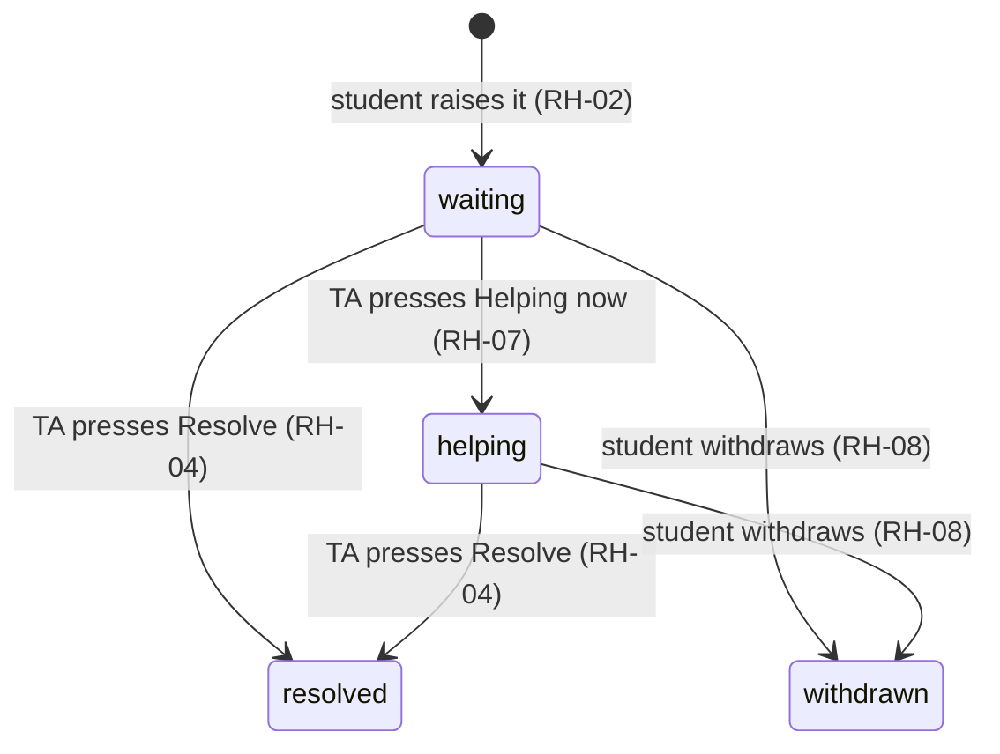

# Architecture

A small Express app with an SQLite database and plain HTML/JS pages. Pages ask the API for updates every 3 seconds, so there are no WebSockets to manage.

## Stack

| Part | Choice | Why |
|---|---|---|
| Server | Node.js 22.13+ with Express 5 | Quick to write routes in |
| Database | SQLite through Node's built-in `node:sqlite` | Nothing extra to install or host |
| Pages | Plain HTML, CSS and JavaScript in `public/` | No build step |
| Live updates | Polling every 3 seconds | Simple, and enough for one lab room |
| Tests | Node's built-in test runner with real HTTP calls through `fetch` | No test framework to install |
| Lint | Biome | One fast tool, one small dependency |
| Hosting | Render, from RH-09 | Deploys every merge to `main` |

## Data model

**sessions**: one row per lab session, used from RH-10.

| Column | Notes |
|---|---|
| id | Primary key |
| code | Short join code, unique |
| status | `open` or `closed` |
| created_at, closed_at | ISO timestamps |

**doubts**: one row per raised doubt.

| Column | Notes |
|---|---|
| id | Primary key, and also the queue order |
| session_id | Empty until RH-10 adds sessions |
| student_name, system_no | From the join form (RH-01) |
| category | `compile-error`, `logic`, `viva`, `other` |
| description | One line, up to 140 characters |
| status | `waiting`, `helping`, `resolved`, `withdrawn` |
| created_at, helping_at, resolved_at | ISO timestamps; wait time is resolved_at minus created_at |

## Doubt lifecycle

A student's **queue position** is the number of `waiting` or `helping` doubts in the same session with a smaller `id`, plus one.

## API

| Story | Method and path | Returns | Owner |
|---|---|---|---|
| Done | `GET /api/health` | `{ "status": "ok" }` | |
| RH-02 | `POST /api/doubts` | 201 with `{ id, position }`, or 400 with `{ error }` | Shivansh |
| RH-06 | `GET /api/doubts/:id` | `{ status, position }` | Shivansh |
| RH-08 | `POST /api/doubts/:id/withdraw` | 204 | Shivansh |
| RH-03 | `GET /api/queue` | Open doubts, oldest first | Harsh |
| RH-04 | `POST /api/doubts/:id/resolve` | 204 | Harsh |
| RH-07 | `POST /api/doubts/:id/helping` | 204 | Harsh |
| RH-10 | `POST /api/sessions` and `POST /api/sessions/:code/close` | `{ code }`, then 204 | Harsh |
| RH-11 | `GET /api/sessions/:code/stats` | Counts, average wait, top category | Shivansh |

Errors always come back as JSON: `{ "error": "message" }`.

## Who edits which files

The split is by screen, so we rarely touch the same file.

| Harsh (TA side) | Shivansh (student side) |
|---|---|
| `src/routes/ta.js`, `public/ta.html`, `public/ta.js` | `src/routes/student.js`, `public/student.html`, `public/student.js`, and a new `src/routes/stats.js` for RH-11 |

`src/db.js`, `src/app.js` and `public/styles.css` are shared: change them in small, separate pull requests and tell the other person first. RH-10 also adds a join-code field to the student page, so pair on that part.

## Security basics

- Every query uses prepared statements with `?` placeholders. No SQL built by joining strings.
- The API validates input: required fields, lengths, allowed categories. Bad input gets a 400 with a clear message.
- Request bodies are capped at 10 kB.
- Pages insert student-written text with `textContent`, never `innerHTML`, so a doubt can't inject HTML.
